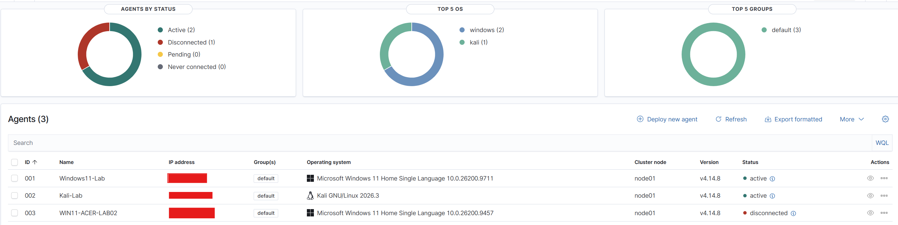
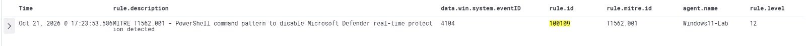

# Enterprise SOC Home Lab | Wazuh SIEM

**Project Status: 🚧 Ongoing Development | Active Build & Testing**

> This is an ongoing cybersecurity engineering project. Features, integrations, detection rules, attack simulations, and documentation are continuously being developed, tested, and improved. Completed implementations are documented with validation evidence, while upcoming capabilities are tracked in the project roadmap.

## Project Navigation

| Section | Description |
|---|---|
| [Project Objectives](#project-objectives) | Purpose and goals of the SOC lab |
| [Lab Environment](#lab-environment) | Infrastructure and technologies used |
| [Wazuh SIEM Dashboard](#wazuh-siem-dashboard) | SIEM deployment and monitoring evidence |
| [Multi-Endpoint Monitoring](#multi-endpoint-monitoring) | Windows and Linux endpoint monitoring |
| [Implemented Capabilities](#implemented-capabilities) | Configured SOC monitoring and detection features |
| [Custom Detection Engineering](#custom-detection-engineering) | Custom Wazuh rules and validated detection evidence |
| [MITRE ATT&CK Simulations](attack-simulations/README.md) | Controlled attack simulation documentation |
| [Detection Case Study — T1562.001](detection-rules/T1562.001-Defender-Impairment.md) | Microsoft Defender command-pattern detection |
| [Project Roadmap](#project-roadmap--development-progress) | Completed, ongoing, and planned work |
| [Project Documentation](#project-documentation) | Technical documentation and supporting resources |
| [Screenshots and Evidence](screenshots/) | Lab screenshots and detection evidence |
| [SOC Lab Architecture](#soc-lab-architecture) | Lab architecture diagram and infrastructure documentation |

### Security Monitoring • Detection Engineering • Threat Hunting • Incident Response

A hands-on, enterprise-style Security Operations Center (SOC) home lab designed to simulate real-world security monitoring, threat detection, incident investigation, and response workflows.

This project demonstrates practical cybersecurity engineering skills through the deployment and configuration of Wazuh SIEM, endpoint monitoring, custom detection rules, security telemetry collection, and MITRE ATT&CK-aligned attack simulations.

## Project Objectives

- Build and maintain a functional, multi-endpoint SOC environment.
- Centralize Windows and Linux security logs using Wazuh.
- Develop and test custom detection rules.
- Simulate adversary techniques mapped to MITRE ATT&CK.
- Investigate alerts and document security incidents.
- Implement additional security monitoring and response capabilities.

## SOC Lab Architecture

The diagram below illustrates my VMware-based SOC home lab, including Windows and Linux endpoint monitoring, centralized security event processing through Wazuh SIEM, Suricata IDS integration, and VirusTotal threat intelligence.

For detailed infrastructure information, security telemetry flow, and planned enhancements, see the [SOC Lab Architecture Documentation](architecture/README.md).

## Lab Environment

| Component | Technology |
|---|---|
| SIEM Platform | Wazuh 4.14.8 |
| SIEM Server | Ubuntu Server 24.04 LTS |
| Virtualization | VMware Workstation Pro |
| Windows Endpoint | Windows 11 |
| Linux Endpoint | Kali Linux |
| Endpoint Protection | Microsoft Defender |
| Threat Intelligence | VirusTotal |
| Attack Framework | MITRE ATT&CK |

## Wazuh SIEM Dashboard

The screenshot below shows my deployed Wazuh SIEM
environment during active lab testing.

**Dashboard observations:**
- Centralized security monitoring through Wazuh
- Active endpoint agents reporting to the SIEM
- Security alerts across multiple severity levels
- Ongoing endpoint monitoring and detection testing

## Multi-Endpoint Monitoring

This ongoing SOC lab includes Wazuh agents deployed
across Windows and Linux endpoints, enabling
centralized security monitoring.

### Registered Endpoints

| Endpoint | Operating System | Status at Capture |
|---|---|---|
| Windows11-Lab | Windows 11 | Active |
| Kali-Lab | Kali Linux | Active |
| WIN11-ACER-LAB02 | Windows 11 | Disconnected |

### Monitoring Capabilities

- Centralized Windows and Linux security telemetry
- Wazuh agent deployment and management
- Endpoint connection and health monitoring
- Security alert collection and investigation

## Implemented Capabilities

- Wazuh Manager, Indexer, and Dashboard deployment
- Windows and Linux agent integration
- Windows Security Event Log monitoring
- File Integrity Monitoring (FIM)
- VirusTotal integration
- Microsoft Defender security telemetry
- EICAR antivirus detection testing
- Custom Wazuh detection rules
- MITRE ATT&CK-aligned detection testing
- Sysmon endpoint telemetry integration
- PowerShell Script Block Logging (Event ID 4104)
- Suricata IDS integration and custom TCP SYN detection

## Custom Detection Engineering

As part of my ongoing Wazuh SOC Home Lab, I develop, test, and validate custom detection rules to identify suspicious endpoint activity and map relevant behaviors to the MITRE ATT&CK framework.

### MITRE ATT&CK Detection Engineering Portfolio

Developed and documented seven custom Wazuh detection rules covering credential access, discovery, persistence, defense evasion, and command-based transfer activity.

Each case study includes detection logic, MITRE ATT&CK mapping, SOC investigation methodology, and available lab evidence.

| MITRE ATT&CK | Detection Use Case | Wazuh Rule | Validation Status |
|---|---|---|---|
| [T1110](detection-rules/T1110-Brute-Force-Detection.md) | Brute Force Detection and Correlation | 100102 | Correlation Validated |
| [T1082](detection-rules/T1082-System-Information-Discovery.md) | System Information Discovery | 100103 | Detection Validated |
| [T1016](detection-rules/T1016-Network-Configuration-Discovery.md) | Network Configuration Discovery | 100104 | Current Rule Validation Pending |
| [T1105](detection-rules/T1105-Ingress-Tool-Transfer.md) | Ingress Tool Transfer Command Detection | 100106 | Command Pattern Validated |
| [T1053.005](detection-rules/T1053.005-Scheduled-Task-Persistence.md) | Scheduled Task Persistence | 100107 | Alert Observed |
| [T1547.001](detection-rules/T1547.001-Registry-Run-Key-Persistence.md) | Registry Run Key Persistence | 100108 | Alert Generation Validated |
| [T1562.001](detection-rules/T1562.001-Defender-Impairment.md) | Microsoft Defender Impairment Command Detection | 100109 | Command Pattern Detected |

**Detection Engineering Workflow:** Telemetry Collection → Rule Development → Attack Simulation → Alert Validation → SOC Investigation → Documentation

> **Note:** Detection of a suspicious command or configuration change does not independently establish successful exploitation, persistence, or compromise. All simulations were performed in an authorized home lab.

[Explore All Detection Engineering Case Studies](detection-rules/README.md)

### Detection Case Study 01 — Microsoft Defender Tampering

| Field | Details |
|---|---|
| MITRE ATT&CK | T1562.001 — Impair Defenses: Disable or Modify Tools |
| Wazuh Rule ID | 100109 |
| Alert Severity | Level 12 |
| Windows Event ID | 4104 — PowerShell Script Block Logging |
| Endpoint | Windows11-Lab |
| Validation Method | Controlled PowerShell command-pattern test |
| Detection Status | Validated — Further testing ongoing |

### Detection Evidence

### Investigation Summary

A custom Wazuh detection rule identified a PowerShell script-block pattern associated with attempts to disable Microsoft Defender real-time protection.

The controlled test successfully generated a Level 12 security alert mapped to MITRE ATT&CK T1562.001. The validation confirms that the detection identified the suspicious command pattern; it does not establish that Microsoft Defender was actually disabled.

### Detailed Detection Engineering Documentation

**[View Full MITRE T1562.001 Detection Case Study](detection-rules/T1562.001-Defender-Impairment.md)**

### Ongoing Detection Engineering

Additional custom detection rules, MITRE ATT&CK simulations, correlation logic, and investigation evidence will be documented as development and testing progress.

## Project Roadmap & Development Progress

**Project Status:** 🚧 Ongoing Development | Active Build & Testing

This project is continuously evolving into an enterprise-style SOC environment. The roadmap below tracks implemented capabilities, current engineering work, and planned integrations.

### Completed & Validated

- [x] Deploy Wazuh SIEM 4.14.8 on Ubuntu Server 24.04 LTS
- [x] Configure Wazuh Manager, Indexer, and Dashboard
- [x] Deploy Windows 11 and Kali Linux Wazuh agents
- [x] Configure Windows Security Event Log collection
- [x] Implement File Integrity Monitoring (FIM)
- [x] Integrate VirusTotal threat intelligence
- [x] Collect Microsoft Defender security telemetry
- [x] Validate EICAR antivirus test detection
- [x] Develop and validate a custom Wazuh detection for MITRE ATT&CK T1562.001
- [x] Document the first controlled detection test and alert evidence
- [x] Deploy and configure Sysmon on Windows11-Lab
- [x] Integrate Sysmon event telemetry into Wazuh
- [x] Configure PowerShell Script Block Logging (Event ID 4104)
- [x] Deploy Suricata IDS 8.0.7 on Kali Linux
- [x] Integrate Suricata IDS alerts into Wazuh
- [x] Validate custom Suricata TCP SYN detection and Wazuh alert ingestion

### In Progress

- [ ] Expand and validate additional custom Wazuh detection rules
- [ ] Develop additional MITRE ATT&CK-aligned test scenarios
- [ ] Improve detection documentation and evidence collection

### Planned — Security Telemetry & Detection

- [ ] Expand Sysmon event coverage and detection rules
- [ ] Enhance PowerShell detection coverage
- [ ] Develop multi-event correlation rules
- [ ] Expand Suricata IDS detection scenarios and tuning
- [ ] Perform structured threat hunting exercises

### Planned — Incident Response & Infrastructure

- [ ] Implement and test Wazuh Active Response
- [ ] Expand vulnerability detection and management workflows
- [ ] Deploy a dedicated Windows target virtual machine
- [ ] Build an Active Directory test environment
- [ ] Simulate and investigate additional endpoint and identity-based attack scenarios
- [ ] Create end-to-end incident investigation and response case studies

### Continuous Improvement

This roadmap is updated as each capability is configured, tested, and validated. Features are only marked complete after implementation and verification.

> **Portfolio Note:** This is an independent, hands-on cybersecurity engineering project conducted in an authorized home lab. It is not presented as a completed production SOC deployment.

## Project Documentation

This repository contains technical documentation,
detection engineering case studies, MITRE ATT&CK
simulation records, and security monitoring evidence.

Additional architecture diagrams, configuration
examples, investigation reports, and response
workflows will be added as development progresses.

- [Detection Engineering](detection-rules/)
- [MITRE ATT&CK Simulations](attack-simulations/)
- [Screenshots and Evidence](screenshots/)
- [Lab Architecture — In Development](architecture/)

## Disclaimer

This project is developed for educational, defensive security research, and professional portfolio purposes. All testing is performed in an authorized home lab environment. Sensitive credentials, private keys, and confidential information are excluded from this repository.
