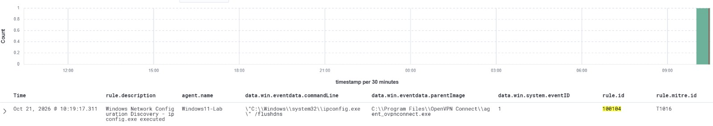

# MITRE ATT&CK T1016 — System Network Configuration Discovery

## Detection Overview

This case study documents custom Wazuh detection engineering for Windows network configuration discovery using Sysmon process creation telemetry.

The detection is mapped to MITRE ATT&CK T1016 — System Network Configuration Discovery.

## Detection Details

| Field | Details |
|---|---|
| Wazuh Rule ID | 100104 |
| Severity | Level 8 |
| MITRE ATT&CK | T1016 |
| Log Source | Sysmon Event ID 1 |
| Endpoint | Windows11-Lab |
| Target Process | ipconfig.exe |
| Current Rule Condition | ipconfig.exe with /all argument |
| Evidence Status | Historical alert observed; current rule validation pending |

## Current Custom Wazuh Rule

```xml
<!-- MITRE ATT&CK T1016 - Network Configuration Discovery -->
<group name="windows,sysmon,discovery,">
  <rule id="100104" level="8">
    <if_group>sysmon_event1</if_group>
    <field name="win.eventdata.image" type="pcre2">(?i)\\ipconfig\.exe$</field>
    <field name="win.eventdata.commandLine" type="pcre2">(?i)(?:^|\s)/all(?:\s|$)</field>
    <description>Windows Network Configuration Discovery - ipconfig /all executed</description>
    <mitre>
      <id>T1016</id>
    </mitre>
    <group>discovery,detection_engineering,</group>
  </rule>
</group>
```

## Detection Logic

The current rule evaluates Sysmon process creation events and checks for:

1. An executable path ending in `\ipconfig.exe`.
2. A command line containing the `/all` argument.

Both conditions must match for the current rule to generate an alert.

## Historical Detection Evidence

The screenshot below shows a Wazuh alert generated under rule 100104 for `ipconfig.exe /flushdns`.



### Evidence Interpretation

The historical alert shows rule 100104 associated with MITRE ATT&CK T1016 on Windows11-Lab.

However, the observed `/flushdns` command does not satisfy the current `/all` condition. The rule configuration at the time of the historical alert has not been verified.

Therefore, this screenshot is retained as historical alert evidence rather than validation of the current rule logic.

## SOC Investigation Approach

When reviewing network configuration discovery alerts, I would:

1. Identify the affected endpoint and executing user.
2. Review the full process command line and parent process.
3. Determine whether execution is consistent with expected administrative or application activity.
4. Correlate nearby Sysmon events and other suspicious processes.
5. Investigate related activity before classifying the alert as malicious.

## Detection Limitations

- Legitimate network troubleshooting can trigger discovery detections.
- The current rule specifically requires `ipconfig.exe /all`.
- The historical alert does not validate the current rule condition.
- Further testing is needed to confirm current detection behavior.

## Next Validation

Execute `ipconfig.exe /all` on an endpoint with active Sysmon and Wazuh monitoring, then verify that rule 100104 generates a corresponding alert.
