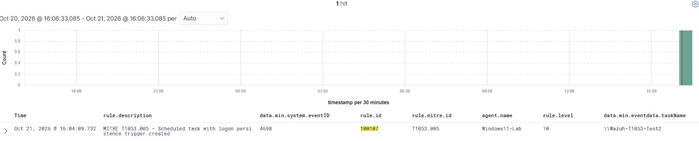

# MITRE ATT&CK T1053.005 — Scheduled Task Persistence

## Detection Overview

This case study documents a custom Wazuh detection rule developed in my Enterprise SOC Home Lab to identify Windows scheduled task creation events containing a logon trigger.

The detection is mapped to MITRE ATT&CK T1053.005 — Scheduled Task/Job: Scheduled Task.

## Detection Details

| Field | Value |
|---|---|
| Wazuh Rule ID | 100107 |
| Severity | Level 10 |
| MITRE ATT&CK | T1053.005 |
| Parent Wazuh Rule | 60228 |
| Expected Event ID | 4698 — A scheduled task was created |
| Monitored Field | `win.eventdata.taskContent` |
| Detection Pattern | `LogonTrigger` |
| Status | Rule configuration verified; alert evidence previously observed |

## Custom Wazuh Detection Rule

```xml
<!-- MITRE ATT&CK T1053.005 - Scheduled Task Persistence -->
<group name="windows,scheduled_task,persistence,">

  <rule id="100107" level="10">
    <if_sid>60228</if_sid>
    <field name="win.eventdata.taskContent" type="pcre2">(?i)LogonTrigger</field>
    <description>MITRE T1053.005 - Scheduled task with logon persistence trigger created</description>
    <mitre>
      <id>T1053.005</id>
    </mitre>
    <group>persistence,scheduled_task,detection_engineering,</group>
  </rule>
</group>
```

## Detection Logic

The custom rule evaluates events matching Wazuh rule 60228 and searches the scheduled task definition for the `LogonTrigger` pattern.

When the configured conditions match, Wazuh generates a Level 10 alert mapped to MITRE ATT&CK T1053.005.

This detection identifies a persistence-capable scheduled task configuration but does not independently establish malicious intent or subsequent task execution.

## Detection Evidence

The following screenshot shows a Wazuh alert associated with custom rule 100107, mapped to MITRE ATT&CK T1053.005 — Scheduled Task/Job: Scheduled Task.



### Detection Summary

| Field | Value |
|---|---|
| Wazuh Rule ID | 100107 |
| Alert Severity | Level 10 |
| MITRE ATT&CK | T1053.005 |
| Windows Event ID | 4698 |
| Detection Objective | Identify scheduled task creation with a logon trigger |

### Investigation Finding

The custom rule is designed to detect scheduled task creation events containing a `LogonTrigger` pattern.

A matching alert demonstrates visibility into a potential persistence mechanism. Additional investigation is required to determine whether the scheduled task was authorized and whether it executed.


## SOC Investigation Approach

When investigating this detection, I would:

1. Identify the endpoint and account that created the scheduled task.
2. Review the task name, executable path, arguments, and trigger configuration.
3. Examine the scheduled task XML content.
4. Determine whether the task was created by an authorized administrator or legitimate application.
5. Correlate related process creation, PowerShell, and registry events.
6. Investigate whether the task executed and what actions it performed.
7. Recommend removal or containment if unauthorized persistence is confirmed.

## Detection Limitations

- Legitimate software may create logon-triggered scheduled tasks.
- The rule searches for the `LogonTrigger` pattern and does not verify that the task executed.
- The detection depends on the relevant Windows events being collected and decoded.
- Additional context is required before classifying the activity as malicious.

## Future Improvements

- Detect suspicious task execution paths and command-line arguments.
- Correlate task creation with subsequent process execution.
- Identify scheduled tasks created by unusual accounts.
- Expand coverage to other scheduled task trigger types.
- Tune detections to reduce expected administrative activity.

## Conclusion

This detection demonstrates Wazuh custom rule development, Windows scheduled task monitoring, MITRE ATT&CK mapping, and SOC investigation methodology within an authorized home lab.
