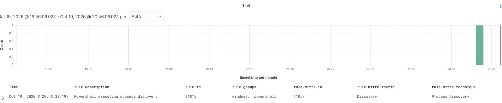
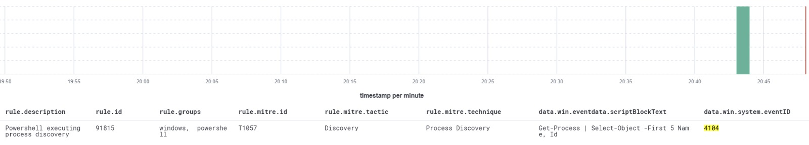
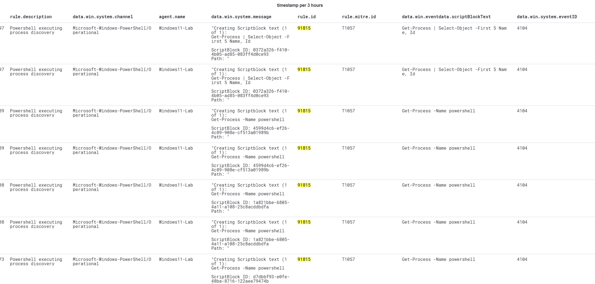

# MITRE ATT&CK T1057 — Process Discovery

**Detection Status:** Alert Generation and Rule Logic Validated

## 1. Overview

This case study documents the detection and investigation of PowerShell-based process discovery activity using Wazuh SIEM in my Enterprise SOC Home Lab.

The objective is to identify process enumeration commands, examine the associated Windows security telemetry, and validate alert generation mapped to MITRE ATT&CK T1057 — Process Discovery.

Process discovery can be used by adversaries to identify running applications, security tools, and other software. However, the same activity is common during legitimate system administration and troubleshooting, making contextual investigation essential.

## 2. MITRE ATT&CK Mapping

| Field | Description |
|---|---|
| Tactic | Discovery |
| Technique | T1057 — Process Discovery |
| Platform | Windows |
| Telemetry Source | PowerShell Operational Logs |
| SIEM | Wazuh |
| Detection Focus | PowerShell-based process enumeration |

## 3. Detection Evidence

### Wazuh Detection Evidence

The Wazuh Threat Hunting dashboard displayed alerts associated with PowerShell process discovery activity on the monitored Windows endpoint.



### Additional Investigation Evidence

Additional captured evidence supports the review of PowerShell process discovery activity and its associated Wazuh alerts.



## 4. SOC Investigation Workflow

The investigation workflow covers the following activities:

1. Identify the PowerShell process discovery alert in Wazuh Threat Hunting.
2. Review the detection rule, MITRE ATT&CK mapping, and alert details.
3. Examine the PowerShell script-block content.
4. Identify the affected endpoint and available user context.
5. Review timestamps, repeated events, and related activity.
6. Assess whether the commands are consistent with authorized administration or controlled testing.
7. Correlate with additional endpoint telemetry where available.
8. Document the findings and validation limitations.

## 5. Wazuh Detection Rule Analysis

The observed alerts were generated by Wazuh's built-in PowerShell detection rule `91815`.

### Rule Configuration

```xml
<rule id="91815" level="4">
  <if_sid>91802</if_sid>
  <field name="win.eventdata.scriptBlockText" type="pcre2">(?i)Get-Process</field>
  <options>no_full_log</options>
  <description>Powershell executing process discovery</description>
  <mitre>
    <id>T1057</id>
  </mitre>
</rule>
```

### Detection Logic

| Component | Description |
|---|---|
| Rule ID | 91815 |
| Rule Source | Built-in Wazuh PowerShell ruleset |
| Rule Level | 4 |
| Parent Rule | 91802 |
| Monitored Field | win.eventdata.scriptBlockText |
| Detection Expression | `(?i)Get-Process` |
| MITRE ATT&CK | T1057 — Process Discovery |
| Rule File | 0915-win-powershell_rules.xml |

The rule uses a case-insensitive regular expression to identify the `Get-Process` string within decoded PowerShell script-block telemetry.

The rule depends on parent rule `91802`, which should be evaluated separately when documenting the complete event-matching chain.

### Detection Rule Chain Analysis

Wazuh Rule `91815` is part of the built-in PowerShell detection ruleset and depends on parent Rules `91802` and `91801`.

| Rule ID | Level | Detection Condition |
|---|---|---|
| 91801 | 0 | Identifies events from the PowerShell Operational channel after upstream Windows rules 60000 or 60010 |
| 91802 | 0 | Requires a nonempty `win.eventdata.ScriptBlockId` |
| 91815 | 4 | Matches the case-insensitive `Get-Process` pattern in `win.eventdata.scriptBlockText` |

Rules `91801` and `91802` are intermediate grouping rules configured at Level 0.

Rule `91815` evaluates the PowerShell script-block content and generates a Level 4 alert mapped to MITRE ATT&CK T1057 — Process Discovery.

The complete rule chain has been verified against the installed Wazuh ruleset. The source Windows Event ID remains pending verification.

### Detection Considerations

Rule `91815` is a built-in Wazuh detection rule, not a custom rule developed for this lab.

Its case-insensitive expression matches the `Get-Process` string in PowerShell script-block telemetry without determining whether the activity is malicious.

Legitimate administration and troubleshooting may therefore trigger the rule, requiring additional investigation to distinguish expected activity from potentially suspicious process discovery.

## 6. Detection Validation Results

Wazuh Threat Hunting displayed PowerShell process discovery alerts from the `Windows11-Lab` endpoint on October 19, 2026.

### Observed Alert Details

| Field | Observed Value |
|---|---|
| MITRE ATT&CK Technique | T1057 — Process Discovery |
| Wazuh Rule ID | 91815 |
| Rule Description | PowerShell executing process discovery |
| Endpoint | Windows11-Lab |
| Log Channel | Microsoft-Windows-PowerShell/Operational |
| Detection Date | October 19, 2026 |
| Dashboard Search Results | 20 matching alert records |
| Validation Status | Alert Generation Validated |
| Windows Event ID | 4104 — PowerShell Script Block Logging |
| Rule Severity | Level 4 |
| Rule Type | Built-in Wazuh PowerShell rule |
| Rule Chain | 91801 → 91802 → 91815 |

### Windows Event ID 4104 Validation Evidence

The Wazuh Threat Hunting dashboard confirmed that PowerShell process discovery alerts originated from Windows Event ID `4104` in the `Microsoft-Windows-PowerShell/Operational` channel.

The captured evidence shows Wazuh Rule `91815`, MITRE ATT&CK T1057 mapping, the affected endpoint, and the associated PowerShell script-block commands.



### Observed PowerShell Commands

The following process enumeration commands appeared in the collected script-block telemetry:

```powershell
Get-Process -Name powershell
```

Enumerates running PowerShell processes.

```powershell
Get-Process | Select-Object -First 5 Name, Id
```

Retrieves process names and IDs for the first five returned processes.

### Investigation Findings

The observed events demonstrate that Wazuh generated alerts for PowerShell process enumeration activity and associated them with MITRE ATT&CK T1057.

The dashboard returned 20 matching alert records during the selected search period. These records do not necessarily represent 20 distinct command executions.

**Validation Result: Alert Generation Validated**

The evidence supports detection of the observed commands and centralized visibility through Wazuh Threat Hunting.

### Validation Limitations

The Windows Event ID, rule configuration, severity, parent rule chain, and MITRE ATT&CK mapping have been verified.

The available evidence confirms that Wazuh generated alerts for PowerShell process discovery commands. However, a separately documented repeatability test has not yet been completed.

Because `Get-Process` is also used during legitimate system administration, the detection requires additional context to distinguish authorized activity from suspicious reconnaissance.

The alerts do not independently establish malicious intent or successful compromise.

## 7. Future Improvements

- Inspect the definition of Wazuh Rule `91815` and document its detection conditions.
- Confirm the source Windows Event ID and rule severity.
- Perform a controlled test to verify reproducibility.
- Correlate PowerShell events with Sysmon process creation telemetry.
- Evaluate additional process discovery commands and potential detection gaps.
- Improve contextual analysis to distinguish legitimate administration from suspicious reconnaissance.

## Conclusion

This case study demonstrates the detection and investigation of PowerShell-based process discovery activity using Wazuh SIEM.

Windows Event ID `4104`, built-in Wazuh Rule `91815`, Level 4 severity, the parent rule chain, and MITRE ATT&CK T1057 mapping were verified.

The observed evidence validates alert generation and the configured detection logic. Additional controlled testing and contextual correlation can further improve detection reliability and investigation accuracy.
