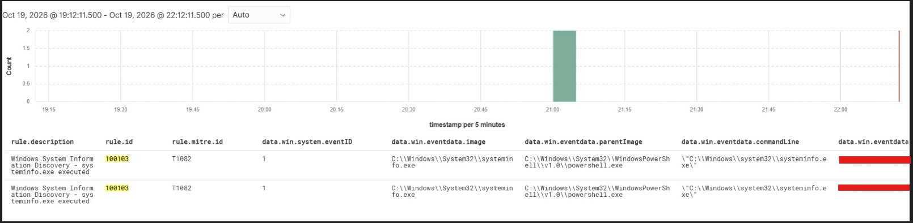

# MITRE ATT&CK T1082 — System Information Discovery

## Detection Overview

This case study documents a custom Wazuh detection rule developed in my Enterprise SOC Home Lab to identify execution of the Windows `systeminfo.exe` utility using Sysmon process creation telemetry.

The detection is mapped to MITRE ATT&CK T1082 — System Information Discovery.

## Detection Details

| Field | Value |
|---|---|
| Wazuh Rule ID | 100103 |
| Severity | Level 8 |
| MITRE ATT&CK | T1082 |
| Data Source | Sysmon |
| Event ID | 1 — Process Creation |
| Monitored Field | `win.eventdata.image` |
| Target Executable | `systeminfo.exe` |
| Detection Status | Alert observed in Wazuh |

## Custom Wazuh Detection Rule

```xml
<!-- Custom MITRE ATT&CK T1082 Detection -->
<group name="windows,sysmon,discovery,">

  <rule id="100103" level="8">
    <if_group>sysmon_event1</if_group>
    <field name="win.eventdata.image" type="pcre2">(?i)\\systeminfo\.exe$</field>
    <description>Windows System Information Discovery - systeminfo.exe executed</description>
    <mitre>
      <id>T1082</id>
    </mitre>
    <group>discovery,detection_engineering,</group>
  </rule>
</group>
```

## Detection Logic

The rule evaluates events belonging to the `sysmon_event1` group and inspects the executable path in `win.eventdata.image`.

The PCRE2 expression identifies paths ending in `\systeminfo.exe`, without case sensitivity.

A matching event generates a Level 8 alert associated with MITRE ATT&CK T1082.

## Detection Evidence

The following screenshot shows the custom Wazuh detection rule identifying execution of `systeminfo.exe` through Sysmon process creation telemetry.



### Observed Alert Details

| Field | Observed Value |
|---|---|
| Wazuh Rule ID | 100103 |
| Alert Level | 8 |
| MITRE ATT&CK | T1082 |
| Windows Event ID | 1 |
| Process | systeminfo.exe |
| Detection Result | Matching alert generated |

## SOC Investigation Approach

When investigating this alert, I would:

1. Identify the endpoint and user associated with the process.
2. Review the process command line, parent process, and execution time.
3. Correlate related Sysmon events and Windows security logs.
4. Determine whether the activity was expected administrative behavior or suspicious discovery.
5. Search for additional reconnaissance or post-exploitation indicators.

## Detection Limitations

- The rule detects execution of `systeminfo.exe`, not every possible system discovery technique.
- Legitimate administrative activity can trigger this detection.
- Additional process context and correlation are needed before classifying the event as malicious.
- Detection depends on Sysmon process creation events being collected and forwarded to Wazuh.

## Future Improvements

- Correlate discovery activity with suspicious parent processes.
- Add related discovery utilities and command patterns.
- Enrich investigation results with additional endpoint telemetry.
- Tune alert severity based on execution context.

## Conclusion

This detection demonstrates custom Wazuh rule development, Sysmon process monitoring, MITRE ATT&CK mapping, and security alert investigation within an authorized home SOC lab.
