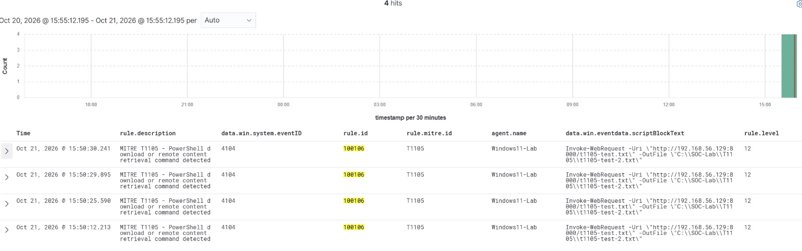

# MITRE ATT&CK T1105 — Ingress Tool Transfer

## Detection Overview

This case study documents a custom Wazuh detection rule developed in my Enterprise SOC Home Lab to identify PowerShell script-block content associated with remote file downloads and content retrieval.

The detection is mapped to MITRE ATT&CK T1105 — Ingress Tool Transfer.

## Detection Details

| Field | Value |
|---|---|
| Wazuh Rule ID | 100106 |
| Severity | Level 12 |
| MITRE ATT&CK | T1105 |
| Parent Wazuh Rule | 91802 |
| Log Source | PowerShell Script Block Logging |
| Monitored Field | `win.eventdata.scriptBlockText` |
| Detection Method | Case-insensitive command-pattern matching |
| Status | Rule verified; alert evidence previously observed |

## Custom Wazuh Detection Rule

```xml
<!-- MITRE ATT&CK T1105 - Ingress Tool Transfer -->
<group name="windows,powershell,ingress_tool_transfer,">

  <rule id="100106" level="12">
    <if_sid>91802</if_sid>
    <field name="win.eventdata.scriptBlockText" type="pcre2">(?i)(Invoke-WebRequest|iwr|Start-BitsTransfer|DownloadFile|DownloadString)</field>
    <description>MITRE T1105 - PowerShell download or remote content retrieval command detected</description>
    <mitre>
      <id>T1105</id>
    </mitre>
    <group>powershell,attack,ingress_tool_transfer,</group>
  </rule>
</group>
```

## Detection Logic

The custom rule evaluates events matching Wazuh rule 91802 and searches the PowerShell script-block text for command patterns associated with downloading files or retrieving remote content.

A matching event can generate a Level 12 alert mapped to MITRE ATT&CK T1105.

The rule does not independently verify whether a download completed successfully.

## Observed Lab Activity

During previous lab testing, a PowerShell `Invoke-WebRequest` command was observed retrieving content from a lab-hosted HTTP service.

The resulting Wazuh alert was associated with custom rule 100106.

The activity was performed within an authorized home lab and does not represent a confirmed malicious intrusion.

## Detection Evidence

The screenshot below shows Wazuh detecting PowerShell `Invoke-WebRequest` activity through Windows Event ID 4104.

The detection generated four matching alerts under custom rule 100106, with severity Level 12 and MITRE ATT&CK mapping T1105.



### Observed Alert Details

| Field | Value |
|---|---|
| Endpoint | Windows11-Lab |
| Wazuh Rule ID | 100106 |
| Alert Level | 12 |
| Windows Event ID | 4104 |
| MITRE ATT&CK | T1105 |
| Observed Command | Invoke-WebRequest |
| Matching Alerts | 4 |
| Detection Result | PowerShell command pattern detected |

### Investigation Finding

The Wazuh detection successfully identified PowerShell script-block content associated with remote content retrieval. The observed activity was part of authorized lab testing.

The evidence validates command-pattern detection, but does not independently establish successful file transfer or malicious execution.
.

## SOC Investigation Approach

When investigating this detection, I would:

1. Identify the endpoint, executing user, and PowerShell process.
2. Review the complete script-block content and command arguments.
3. Identify the remote destination, URL, and requested file.
4. Correlate process creation, network connections, and file creation events.
5. Check whether the downloaded content was saved or executed.
6. Evaluate file hashes and available reputation information.
7. Determine whether the activity was authorized administration, software deployment, or suspicious remote content retrieval.

## Detection Limitations

- Legitimate administrative scripts and software installers may trigger this rule.
- The rule matches command patterns rather than confirmed successful transfers.
- Short patterns such as `iwr` may produce false positives because they are not constrained to command boundaries.
- Additional endpoint and network evidence is needed to establish malicious intent.

## Future Improvements

- Improve command matching to reduce false positives.
- Correlate download commands with file creation events.
- Enrich observed URLs and file hashes with threat intelligence.
- Identify suspicious downloads followed by execution.
- Tune detection severity based on process context.

## Conclusion

This case study demonstrates custom PowerShell detection engineering, Wazuh rule development, MITRE ATT&CK mapping, and SOC investigation methodology within an authorized home lab.
