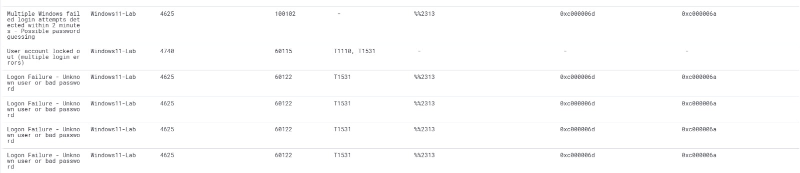
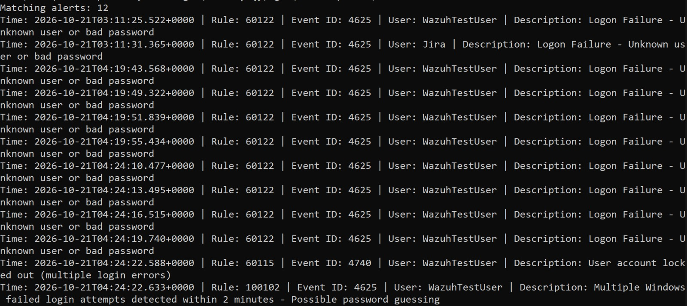

# MITRE ATT&CK T1110 — Brute Force Detection

## Detection Overview

This case study documents a custom Wazuh correlation rule developed in my Enterprise SOC Home Lab to identify repeated Windows authentication failures within a defined time window.

The detection is mapped to MITRE ATT&CK T1110 — Brute Force.

## Detection Details

| Field | Value |
|---|---|
| Wazuh Rule ID | 100102 |
| Severity | Level 10 |
| MITRE ATT&CK | T1110 — Brute Force |
| Detection Type | Event correlation |
| Parent Rule | 60122 |
| Frequency | 5 |
| Timeframe | 120 seconds |
| Relevant Windows Event | 4625 — Failed Logon |
| Detection Status | Rule configuration verified; alert evidence observed |

## Custom Wazuh Detection Rule

```xml
<!-- Custom Windows Failed Login Correlation -->
<group name="windows,authentication_failed,correlation,">

  <rule id="100102" level="10" frequency="5" timeframe="120">
    <if_matched_sid>60122</if_matched_sid>
    <description>Multiple Windows failed login attempts detected within 2 minutes - Possible password guessing</description>
    <mitre>
      <id>T1110</id>
    </mitre>
    <group>authentication_failed,brute_force,detection_engineering,</group>
  </rule>
</group>
```

## Detection Logic

The custom rule correlates repeated events that match Wazuh rule 60122 within a 120-second timeframe.

When the configured frequency condition is satisfied, Wazuh can generate a Level 10 alert indicating possible password guessing or brute-force activity.

The rule does not explicitly correlate by source IP address or target username.


## Detection Evidence

### Evidence 1 — Wazuh Brute Force Detection

The Wazuh dashboard shows custom rule 100102 identifying repeated Windows authentication failures on Windows11-Lab. Related events include failed logons (Event ID 4625) and an account lockout (Event ID 4740).



### Evidence 2 — Authentication Correlation

The supporting evidence shows repeated authentication failure alerts matching Wazuh rule 60122, an account lockout alert under rule 60115, and the custom correlation alert under rule 100102.



### Investigation Findings

- Multiple failed Windows authentication events were observed.
- Wazuh generated the custom correlation alert under rule 100102.
- A related account lockout event was observed.
- The evidence demonstrates detection of repeated authentication failures, not a confirmed account compromise.

## SOC Investigation Approach

When investigating this alert, I would:

1. Identify the affected endpoint and target accounts.
2. Review the source IP addresses and authentication failure timestamps.
3. Analyze Windows Event ID 4625 and associated failure status codes.
4. Check for related account lockout events (Event ID 4740).
5. Look for successful authentication events (Event ID 4624) following the failures.
6. Determine whether the activity represents legitimate user errors, application misconfiguration, or possible password guessing.
7. Recommend appropriate containment and remediation if malicious activity is confirmed.

## Detection Limitations

- Repeated authentication failures do not automatically confirm a brute-force attack.
- The rule does not explicitly group events by source IP or target username.
- Legitimate password errors can generate similar patterns.
- Further investigation is required to establish malicious intent.

## Future Improvements

- Correlate failures by source IP address or target username.
- Detect successful authentication following repeated failures.
- Distinguish password spraying from single-account password guessing.
- Tune thresholds to reduce false positives.
- Add supporting account lockout investigation evidence.

## Conclusion

This detection demonstrates Wazuh event correlation, Windows authentication monitoring, custom rule development, MITRE ATT&CK mapping, and SOC investigation methodology within an authorized home lab.
