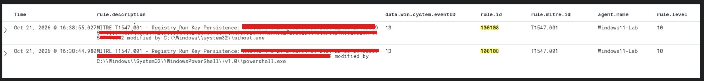

# MITRE ATT&CK T1547.001 — Registry Run Key Persistence

## Detection Overview

This case study documents a custom Wazuh detection rule developed in my Enterprise SOC Home Lab to identify Windows Registry Run key modifications using Sysmon telemetry.

The detection is mapped to MITRE ATT&CK T1547.001 — Boot or Logon Autostart Execution: Registry Run Keys / Startup Folder.

## Detection Details

| Field | Value |
|---|---|
| Wazuh Rule ID | 100108 |
| Severity | Level 10 |
| Parent Wazuh Rule | 92300 |
| Log Source | Sysmon |
| Expected Sysmon Event ID | 13 — Registry Value Set |
| Event Type | SetValue |
| Monitored Field | `win.eventdata.targetObject` |
| MITRE ATT&CK | T1547.001 |
| Status | Alert Generation Validated — Detection Tuning Ongoing |

## Custom Wazuh Detection Rule

```xml
<group name="windows,sysmon,registry_persistence,">

  <rule id="100108" level="10">
    <if_sid>92300</if_sid>
    <field name="win.eventdata.eventType">^SetValue$</field>
    <field name="win.eventdata.targetObject" type="pcre2">(?i)\\\\CurrentVersion\\\\Run\\\\[^\\]+$</field>
    <description>MITRE T1547.001 - Registry Run Key Persistence: $(win.eventdata.targetObject) modified by $(win.eventdata.image)</description>
    <mitre>
      <id>T1547.001</id>
    </mitre>
    <group>persistence,registry_run_key,</group>
  </rule>
</group>
```

## Detection Logic

The rule evaluates Sysmon registry events matching parent Wazuh rule 92300.

It requires the event type to be `SetValue` and applies a case-insensitive regular expression to the registry target path to identify modifications associated with Windows Run keys.

A successful match generates a Level 10 alert mapped to MITRE ATT&CK T1547.001.

## Security Relevance

Windows Run keys allow programs to launch automatically during user logon.

Although this behavior is common for legitimate software, threat actors may abuse Run keys to maintain persistence.

A matching registry modification alone does not confirm malicious activity or successful persistence.

## Detection Evidence

The following screenshot was captured during testing of the custom Wazuh detection for MITRE ATT&CK T1547.001 — Registry Run Keys / Startup Folder.



### Detection Validation Results

The custom Wazuh rule `100108` successfully generated two Level 10 alerts during registry modification testing on the Windows11-Lab endpoint.

Both alerts were associated with Sysmon Event ID 13 and mapped to MITRE ATT&CK T1547.001 — Registry Run Keys / Startup Folder.

Sensitive registry path information was intentionally redacted from the published screenshot to maintain privacy and security.

**Validation Status:** Alert generation confirmed. Further tuning and exact registry path matching validation remain separate activities.

### Detection Configuration

| Field | Value |
|---|---|
| Wazuh Rule ID | 100108 |
| Severity | Level 10 |
| MITRE ATT&CK | T1547.001 |
| Expected Sysmon Event ID | 13 |
| Event Type | SetValue |
| Detection Objective | Monitor Windows Registry Run key modifications |

### Investigation Finding

The custom detection is designed to identify registry value modifications associated with Windows Run keys, which may be used for persistence.

The rule configuration has been verified. Validation of the exact registry path matching behavior against the observed Sysmon event remains pending.

A registry modification alone does not confirm malicious persistence or subsequent execution.
.

## SOC Investigation Approach

1. Identify the affected endpoint and registry value.
2. Review the full registry path and newly configured value data.
3. Identify the process responsible for the modification.
4. Review the executable path, command line, and associated user.
5. Correlate Sysmon process creation and PowerShell events.
6. Investigate whether the configured executable subsequently ran.
7. Determine whether the modification was authorized.
8. Recommend containment and remediation if malicious persistence is confirmed.

## Detection Limitations

- Legitimate applications frequently modify Registry Run keys.
- The current rule focuses on the configured Run key path pattern.
- Detection depends on Sysmon collection and Wazuh decoding.
- The rule does not independently establish malicious intent or execution.
- The registry path expression requires validation against observed event data.

## Future Improvements

- Expand coverage to RunOnce keys and additional autorun locations.
- Detect suspicious executable paths and command-line arguments.
- Correlate registry changes with subsequent process execution.
- Identify unusual processes modifying autorun locations.
- Tune known legitimate startup modifications.

## Conclusion

This case study demonstrates custom Wazuh rule development, Sysmon registry monitoring, MITRE ATT&CK mapping, and persistence-focused SOC investigation methodology.
