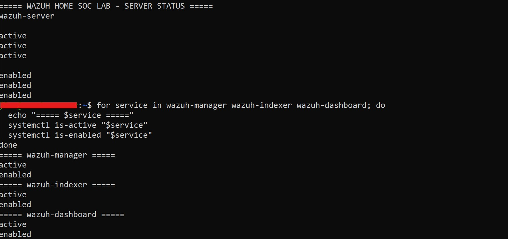
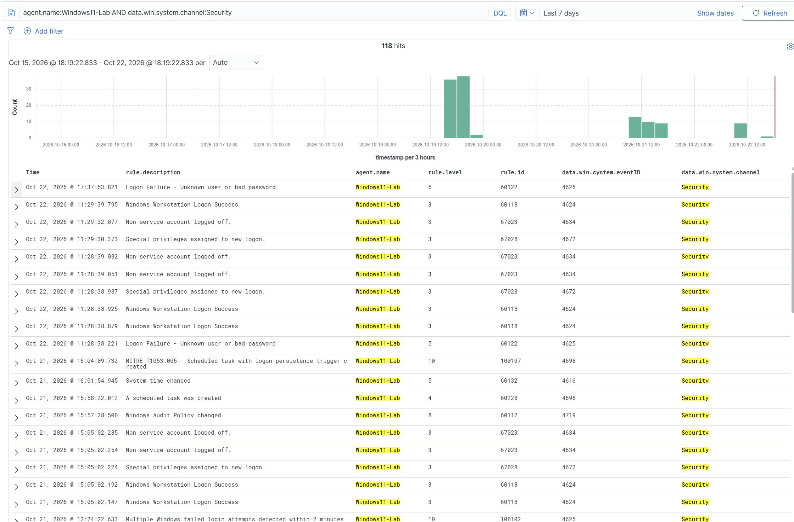
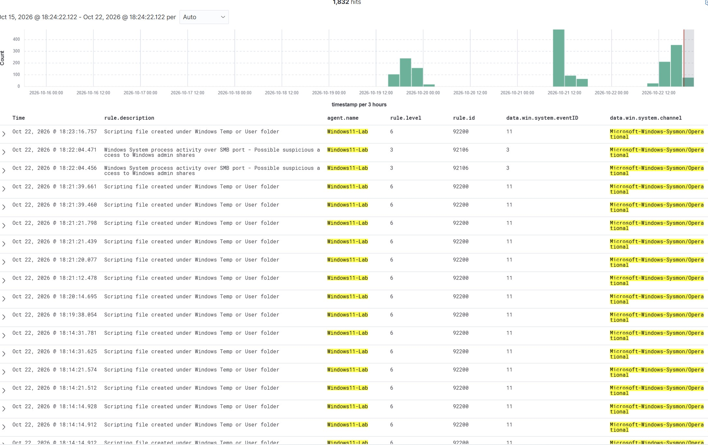
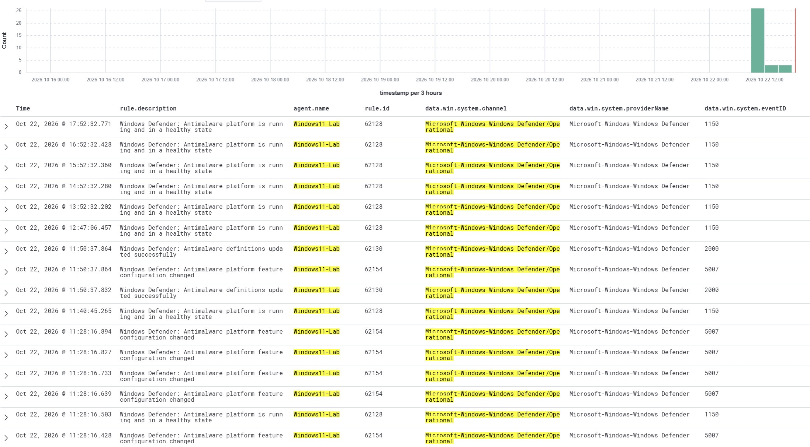
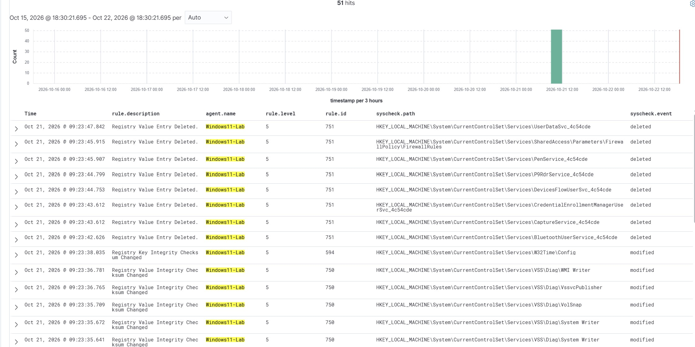
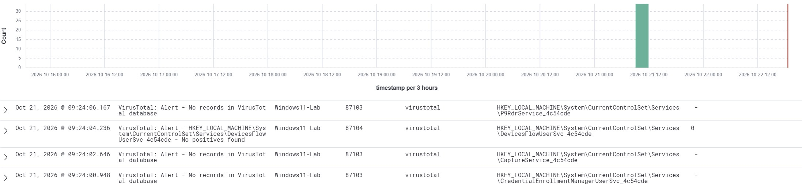

# Security Monitoring and Integrations

**Project Status:** Ongoing Development | Active Build & Testing

## Overview

This section documents the security monitoring capabilities and integrations implemented in my Wazuh Enterprise SOC Home Lab.

The objective is to demonstrate centralized security telemetry collection, endpoint monitoring, detection validation, and security investigation workflows using Wazuh SIEM.

## Monitoring Environment

| Component | Technology | Purpose |
|---|---|---|
| SIEM | Wazuh 4.14.8 | Centralized event analysis and alert monitoring |
| Windows Endpoint | Windows 11 | Windows security and endpoint telemetry |
| Linux Endpoint | Kali Linux | Linux monitoring and Suricata IDS |
| Endpoint Telemetry | Sysmon | Windows process and system activity |
| Script Monitoring | PowerShell Script Block Logging | PowerShell execution visibility |
| Endpoint Protection | Microsoft Defender | Antivirus and endpoint security events |
| File Monitoring | Wazuh FIM | File and registry change monitoring |
| Threat Intelligence | VirusTotal | File hash reputation enrichment |

## 1. Wazuh Server Deployment and Services

Wazuh Manager, Indexer, and Dashboard are deployed on Ubuntu Server 24.04 LTS.

The deployment provides centralized security event processing, alert storage, and investigation capabilities.

### Deployment Evidence

## 2. Windows Security Event Log Monitoring

Windows Security Event Logs are collected through the Wazuh agent to support authentication monitoring, account activity analysis, and security investigations.

Relevant events include authentication failures, account lockouts, and other security auditing activity.

### Monitoring Evidence

## 3. Sysmon Integration

Sysmon is configured on the Windows endpoint to provide additional security telemetry.

Collected events support investigation of process execution, registry changes, and other configured endpoint activities.

Sysmon telemetry is forwarded to Wazuh for centralized analysis.

### Integration Evidence

## 4. Microsoft Defender Monitoring

Microsoft Defender security telemetry is collected through Wazuh to provide visibility into antivirus detections and endpoint protection activity.

Controlled antivirus detection testing was also performed using the EICAR test file.

### Integration Evidence

## 5. File Integrity Monitoring

Wazuh File Integrity Monitoring (FIM) is configured to monitor selected files, directories, and registry locations.

FIM provides visibility into monitored changes that may require security investigation.

### Monitoring Evidence

## 6. VirusTotal Threat Intelligence Integration

VirusTotal is integrated with Wazuh to support file hash reputation checks associated with relevant monitored events.

VirusTotal is an external service, not a component hosted within the VMware lab environment.

### Integration Evidence

## 7. Detection Engineering Integration

Collected security telemetry supports the development and validation of custom Wazuh detection rules.

Detection engineering activities include:

- Windows authentication failure correlation
- Sysmon-based discovery detection
- PowerShell command-pattern detection
- Scheduled task persistence monitoring
- Registry Run key modification detection
- MITRE ATT&CK-aligned detection validation

For individual rules, investigation methodology, and alert evidence, see the [Detection Engineering Documentation](../detection-rules/README.md).

## 8. Current Limitations and Future Improvements

- Expand Windows event collection and Sysmon coverage.
- Improve correlation between different endpoint telemetry sources.
- Continue tuning custom detection rules.
- Develop structured threat hunting investigations.
- Expand monitoring to future Windows and Active Directory lab endpoints.

## Conclusion

These integrations demonstrate the deployment and configuration of centralized endpoint security monitoring within an authorized Wazuh SOC home lab.

The environment remains under active development, with ongoing detection validation, investigation exercises, and monitoring improvements.
