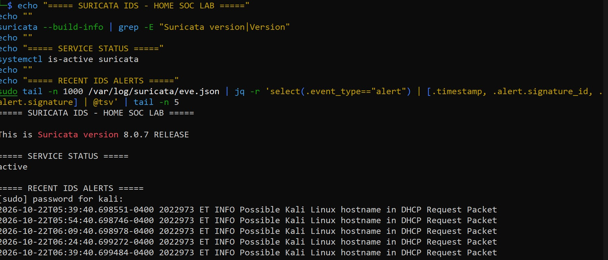
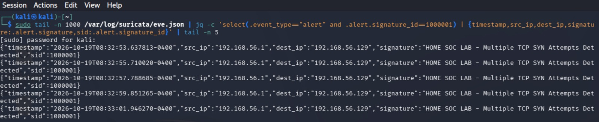
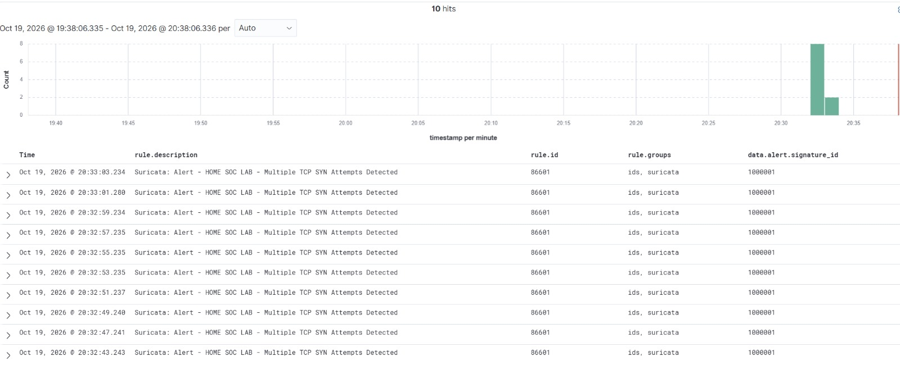
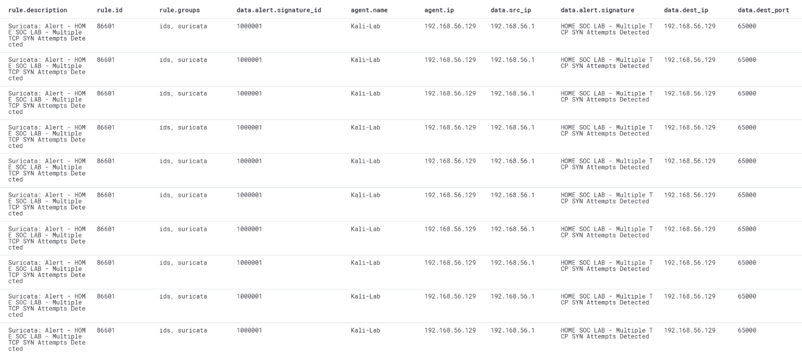

# Suricata IDS — Network Intrusion Detection and Wazuh Integration

**Project Status:** Deployed and Tested | Ongoing Detection Tuning

## Overview

This case study documents the deployment of Suricata IDS on Kali Linux and its integration with Wazuh SIEM in my Enterprise SOC Home Lab.

The objective is to demonstrate network traffic monitoring, custom intrusion detection rules, centralized alert ingestion, and SOC investigation workflows.

## Lab Environment

| Component | Technology |
|---|---|
| IDS Platform | Suricata 8.0.7 |
| IDS Host | Kali Linux |
| SIEM Platform | Wazuh 4.14.8 |
| SIEM Server | Ubuntu Server 24.04 LTS |
| Virtualization | VMware Workstation Pro |
| Network Configuration | VMware NAT |
| Alert Source | Suricata EVE JSON |

## 1. Suricata IDS Deployment

Suricata was installed and configured on Kali Linux to monitor traffic visible to its configured network interface.

The IDS generates security events and alerts based on configured detection signatures.

### Deployment Evidence

## 2. Custom Network Detection

A custom Suricata detection rule was configured to identify TCP SYN traffic patterns during controlled lab testing.

| Field | Value |
|---|---|
| Suricata Signature ID | 1000001 |
| Protocol | TCP |
| Detection Focus | TCP SYN activity |
| Validation | Custom alert observed |

### Custom Detection Evidence

## 3. Wazuh SIEM Integration

Suricata alerts are generated in EVE JSON format and collected through the configured Wazuh integration.

Wazuh processes the collected events and makes the corresponding alerts available for centralized investigation.

### Wazuh Alert Evidence

## 4. Detection Validation

Controlled network traffic testing was performed to verify that the custom Suricata signature generated alerts and that the resulting events were available in Wazuh.

The observed alerts demonstrate detection and ingestion of matching traffic.

They do not independently establish that a network intrusion or successful exploitation occurred.

## 5. SOC Investigation

The investigation workflow includes:

1. Review the Suricata signature ID and alert description.
2. Identify the source and destination IP addresses and ports.
3. Examine protocol information and relevant traffic metadata.
4. Review the event timestamp and detection frequency.
5. Correlate Suricata alerts with available endpoint telemetry.
6. Determine whether the traffic is expected, suspicious, or requires further investigation.
7. Document findings and recommended response actions.

### Investigation Evidence

## 6. Network Visibility and Limitations

The lab uses VMware NAT networking.

Suricata is deployed on Kali Linux and inspects traffic available to its configured network interface.

It does not automatically monitor all network traffic from every endpoint connected to the VMware NAT environment.

Additional routing, traffic mirroring, or network sensor configuration would be required to expand visibility beyond the traffic currently available to Suricata.

## 7. Future Improvements

- Expand custom Suricata signatures and detection coverage.
- Tune signatures to reduce unnecessary alerts.
- Develop additional controlled network attack simulations.
- Correlate network IDS alerts with Windows and Linux endpoint telemetry.
- Document more detailed packet-level investigations where capture data is available.

## Conclusion

This implementation demonstrates Suricata IDS deployment, custom network detection, EVE JSON integration with Wazuh, and centralized SOC investigation workflows.

The lab remains under active development, with additional detection tuning and network monitoring improvements planned.
